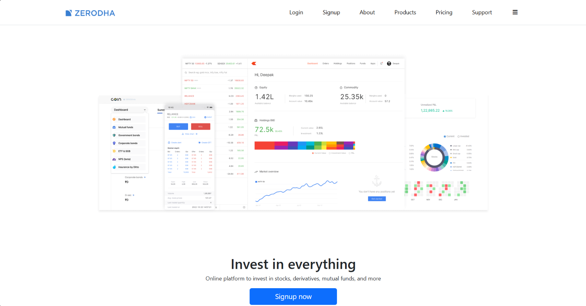
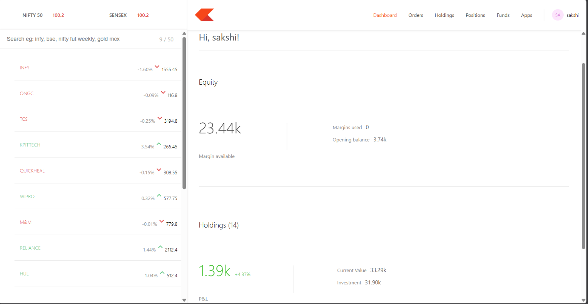
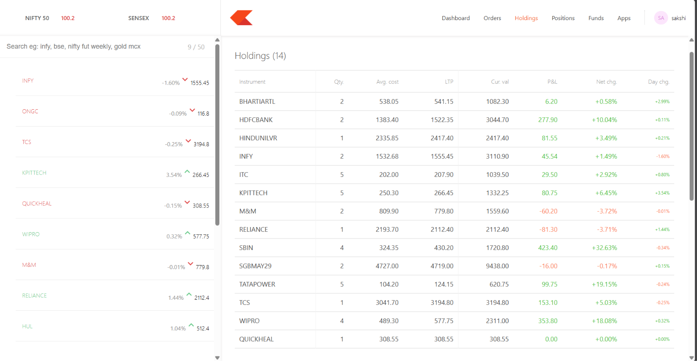
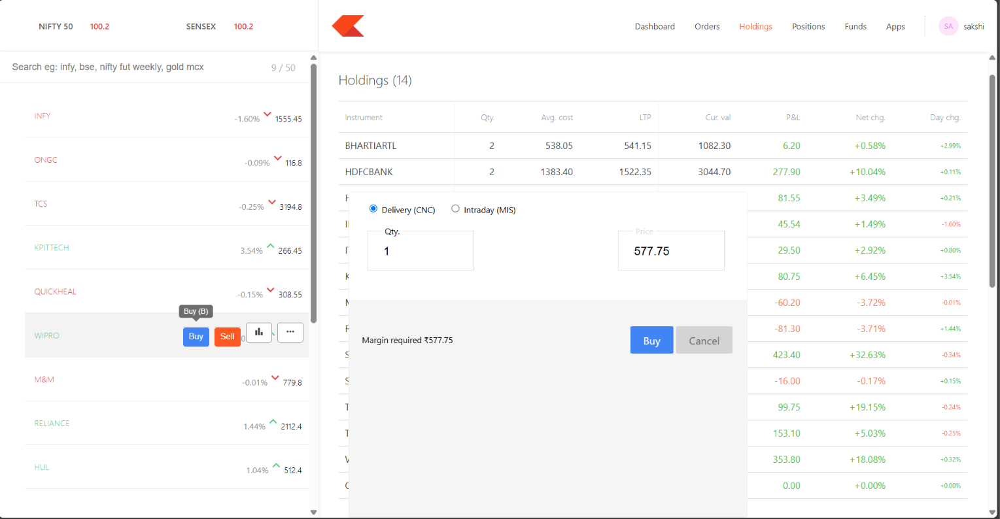

# TradeNest

TradeNest is a full-stack stock trading platform built with the MERN stack,
inspired by Zerodha. It has a marketing website and a trading dashboard with
authentication, per-user portfolios, and buy/sell order handling. Built as a
learning project.




## Features

- Signup, login and logout with JWT stored in an httpOnly cookie, passwords hashed with bcrypt
- Dashboard and API routes protected by authentication middleware
- Per-user holdings, positions, orders and funds balance
- Buy and sell orders with delivery (CNC) and intraday (MIS) product types
- Orders check available funds, update holdings or positions, and adjust the balance
- Add funds and withdraw, with server-side validation
- Watchlist with search; Summary and Holdings totals calculated from real data
- Basic hardening: rate limiting on login/signup, security headers (helmet), CORS with credentials




## Tech stack

React, React Router, Bootstrap, Chart.js, Material UI, Node.js, Express,
MongoDB, Mongoose, JSON Web Tokens, bcryptjs

## Project structure

- `frontend/`: public website, signup and login pages (port 3001)
- `dashboard/`: trading dashboard, "Kite" (port 3000)
- `backend/`: Express API and MongoDB models (port 3002)

## Running locally

1. Clone the repo and install dependencies in each folder:
```bash
   cd backend && npm install
   cd ../frontend && npm install
   cd ../dashboard && npm install
```
2. Backend: copy `backend/.env.example` to `backend/.env` and fill in your
   MongoDB connection string and a long random `TOKEN_KEY`.

3. Frontend and dashboard: copy each `.env.example` to `.env` so they run on ports 3001 and 3000.

4. Start each app in its own terminal, backend first:
```bash
   cd backend && npm start
   cd frontend && npm start
   cd dashboard && npm start
```

5. Open http://localhost:3001 for the website Signing up or logging in takes you to the dashboard at http://localhost:3000.

## Notes

Stock prices are sample data, not live market data.

New accounts start with a demo balance and sample holdings.


## Disclaimer

TradeNest is an educational project inspired by Zerodha and is not affiliated with, endorsed by, or connected to Zerodha in any way. The Zerodha name, logo, and related brand assets belong to their respective owners and appear here only for learning and demonstration purposes. No real trades are placed, no real money is involved, and all prices are sample data.